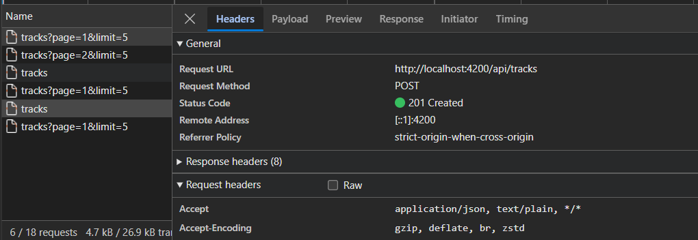
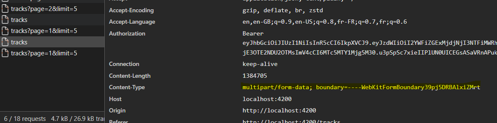
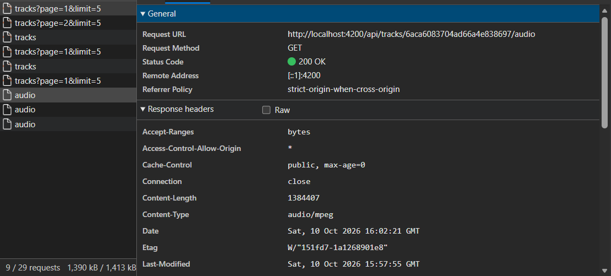
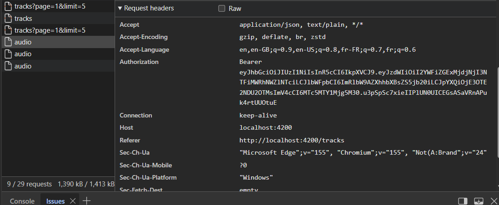
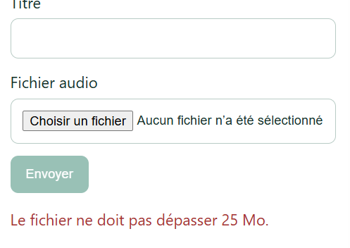
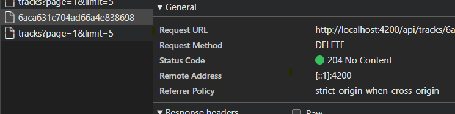
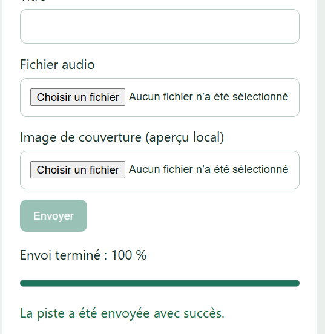

# Rapport d'usage de l'IA - TP1

Pour chaque mission, détailler et fournir des explications concernant : objectif; prompt principal; plan proposé par l'agent; vérifications réalisées par le binôme; erreurs ou propositions rejetées; fichiers effectivement modifiés; preuve de fonctionnement; ce que chaque membre sait maintenant expliquer sans l'agent.

## TP1 - Mission 0 : cartographie

### Objectif

Identifier le composant racine, les routes, l’enregistrement de `HttpClient`, les services, les modèles, les pages et le mécanisme d’ajout du JWT.

### Plan suivi

Lecture des fichiers de démarrage Angular, des routes, des services, de l’intercepteur et du backend correspondant au flux de connexion, puis vérification des points d’entrée HTTP.

### Fichiers modifiés

- `RAPPORT_IA_MODELE.md`

La cartographie s’appuie notamment sur `frontend-starter/src/main.ts`, `frontend-starter/src/app/routes.ts`, `frontend-starter/src/app/components/app/app.ts`, `frontend-starter/src/app/shared/services/auth.service.ts`, `frontend-starter/src/app/shared/interceptors/auth.interceptor.ts` et `backend/src/app.js`.

### Vérifications effectuées

- `GET http://localhost:3000/api/health` : `200 OK`, réponse JSON de santé.
- `GET http://localhost:4200/` : `200 OK`, application Angular servie.
- `GET http://localhost:4200/api/health` : `200 OK`, proxy Angular fonctionnel.
- Les ports 3000 et 4200 étaient déjà occupés par des instances actives ; les doublons n’ont pas été lancés.

### Explication

`AppComponent` fournit la navigation et le `RouterOutlet`. `main.ts` enregistre `provideRouter` et `provideHttpClient` avec `authInterceptor`. `AuthService` encapsule les appels HTTP d’authentification et conserve le token dans le stockage local ainsi que dans un Signal. L’intercepteur lit ce Signal et ajoute l’en-tête Bearer aux requêtes protégées. Le clic de connexion traverse le composant, `AuthService`, `HttpClient`, la route Express et le modèle Mongoose `User`, qui interroge MongoDB.

### À expliquer sans l’agent

Chaque membre doit pouvoir expliquer les rôles suivants :

- **Le composant Angular** gère l’interface et les interactions de l’utilisateur.
  Par exemple, la page de connexion récupère les valeurs du formulaire, vérifie
  les erreurs locales et demande une connexion. Il ne contient pas la logique
  d’accès à MongoDB.
- **Le service Angular** centralise les appels HTTP et la logique réutilisable.
  `AuthService` appelle les routes `/api/auth/login`, `/api/auth/register`,
  `/api/users/me` et conserve l’utilisateur courant dans des Signals. Le
  composant appelle le service au lieu d’utiliser directement `HttpClient`.
- **L’intercepteur** s’exécute automatiquement autour des requêtes HTTP. Ici,
  `authInterceptor` lit le token conservé par `AuthService`, ajoute
  l’en-tête `Authorization: Bearer ...` aux requêtes protégées et traite une
  réponse `401` en déconnectant l’utilisateur puis en le redirigeant vers
  `/login`. Il ne remplace pas le contrôle d’autorisation du backend.
- **Le backend** reçoit les requêtes HTTP, vérifie les données et
  l’authentification, applique les règles métier, interroge les modèles
  Mongoose et renvoie une réponse HTTP. Le flux de connexion est donc :
  composant → `AuthService` → `HttpClient`/intercepteur → API Express →
  modèle `User` → MongoDB, puis la réponse revient dans l’autre sens.

Angular ne communique jamais directement avec MongoDB parce que le navigateur
ne doit pas connaître l’URI MongoDB, les identifiants de base ni les règles
d’accès internes. Une connexion directe exposerait les secrets et permettrait
à un client de contourner les validations, l’authentification et les règles
de propriété. Le backend sert de frontière de sécurité : seul le serveur
possède les informations de connexion MongoDB, valide les entrées, limite les
champs renvoyés et décide quelles opérations sont autorisées. Angular échange
uniquement avec l’API HTTP publique du backend.

## TP2 - Mission 2 : bibliothèque paginée

### Objectif

Afficher les pistes par pages serveur, sans charger puis découper localement
l’ensemble de la bibliothèque.

### Plan suivi

Installation ciblée d’Angular Material, remplacement des boutons de pagination
par `MatPaginator`, ajout des Signals `limit`, `total` et `error`, puis
transmission de `page` et `limit` par `TrackService.list`.

### Fichiers modifiés

- `frontend-starter/package.json`
- `frontend-starter/package-lock.json`
- `frontend-starter/src/app/components/tracks-page/tracks-page.ts`
- `frontend-starter/src/app/components/tracks-page/tracks-page.html`
- `frontend-starter/src/app/components/tracks-page/tracks-page.css`
- `RAPPORT_IA_MODELE.md`

### Vérifications réalisées

- Dépendances `@angular/material` et `@angular/cdk` installées sans vulnérabilité
  signalée par npm.
- Le paginator convertit `pageIndex` en page API avec `pageIndex + 1`.
- Chaque changement de page appelle `TrackService.list(page, limit)` et
  déclenche donc une nouvelle requête HTTP serveur.
- Le template utilise `@if` pour le chargement et `@empty` pour une page vide.
- `npm run build` réussi avec Angular Material.
- `npm run test` ne peut pas démarrer car le projet ne contient aucun fichier
  `*.spec.ts` ou `*.test.ts`.
- Les endpoints déjà démarrés répondent `200` sur `http://localhost:3000/api/health`
  et `http://localhost:4200/`.

### Explication du code

`TracksPageComponent` conserve la page, la limite, le total, le nombre de pages,
la liste, le chargement et l’erreur dans des Signals. `MatPaginator` représente
la pagination et son événement appelle `changePage`, qui met à jour les
paramètres puis relance `load`. `TrackService` reste l’unique couche qui
utilise `HttpClient`; le composant ne connaît que le service.



### Ce que chaque membre sait expliquer sans l’agent

Chaque membre doit pouvoir expliquer que `MatPaginator` émet un `PageEvent`,
que `pageIndex` commence à zéro alors que l’API commence à un, et que
`TrackService.list(page, limit)` transmet ces deux paramètres au backend. La
liste affichée correspond uniquement à la page reçue par HTTP, et non à un
découpage local de toutes les pistes.

Chaque membre doit savoir expliquer que `MatPaginator` représente la pagination
dans l’interface, que `pageIndex` est indexé à partir de zéro côté Angular et
que l’API reçoit une page commençant à un. Il doit aussi savoir vérifier dans
Network qu’un changement de page déclenche une nouvelle requête avec un
paramètre `page` différent. Enfin, il doit distinguer la liste paginée reçue du
serveur d’un éventuel découpage local, qui est interdit dans ce TP.

## TP2 - Mission 3 : upload et lecture audio

### Objectif

Finaliser l’expérience frontend autour de l’upload multipart et de la lecture
audio authentifiée, sans réimplémenter ni modifier le backend.

### Plan suivi

Ajout des contrôles MIME/taille côté navigateur, des états d’envoi et des
messages accessibles, puis enrichissement des cards avec les métadonnées.
La lecture utilise toujours `TrackService.audio`, reçoit un `Blob`, crée un
`ObjectURL` et révoque l’ancienne URL puis la dernière à la destruction.

### Fichiers modifiés

- `frontend-starter/src/app/components/tracks-page/tracks-page.ts`
- `frontend-starter/src/app/components/tracks-page/tracks-page.html`
- `frontend-starter/src/app/components/tracks-page/tracks-page.css`
- `RAPPORT_IA_MODELE.md`

### Vérifications réalisées

- Le `FormData` existant conserve exactement les champs `audio` et `title`
  dans `TrackService.upload`.
- Les formats frontend acceptés correspondent aux formats backend et la taille
  est limitée à 25 Mo avant l’appel HTTP.
- Le bouton est désactivé pendant l’envoi et la réponse serveur est affichée
  en succès ou en erreur.
- Après succès, le formulaire est vidé et la première page est rechargée.
- Une seule piste est chargée à la demande avec `GET /api/tracks/:id/audio`;
  aucun fichier audio n’est téléchargé lors de l’affichage de la liste.
- `npm run build` réussi. `npm run test` reste indisponible car aucun fichier
  de test `*.spec.ts` ou `*.test.ts` n’existe dans le projet.
- `GET http://localhost:3000/api/health` et `GET http://localhost:4200/`
  répondent `200`.

### Explication du flux

Le choix du fichier se fait dans `TracksPageComponent.choose`. La validation
frontend est réalisée par `isValidFile`, qui contrôle le type MIME et la taille
maximale. `TracksPageComponent.upload` appelle ensuite
`TrackService.upload`; la construction du `FormData` se trouve dans la méthode
`upload` de `frontend-starter/src/app/shared/services/track.service.ts`, avec
exactement `body.append('audio', file)` et `body.append('title', title)`.
L’appel `HttpClient.post` est donc effectué par le service, jamais directement
par le composant.

Pour la lecture, `TracksPageComponent.play` appelle `TrackService.audio`. Le
service exécute `HttpClient.get('/api/tracks/${id}/audio', { responseType:
'blob' })`. `main.ts` enregistre `authInterceptor`, et
`auth.interceptor.ts` ajoute le JWT à cette requête protégée. Une URL placée
directement dans l’attribut `src` d’un élément `<audio>` est chargée par le
navigateur comme une ressource indépendante : le code Angular ne contrôle pas
automatiquement ses en-têtes et le navigateur ne réutilise pas l’intercepteur
`HttpClient`. C’est pourquoi le Blob est d’abord demandé par le service.

Après réception, `play` révoque l’ancienne URL avec
`URL.revokeObjectURL`, crée la nouvelle avec `URL.createObjectURL(blob)` et
place cette URL dans le Signal `audioUrl`, lié à `[src]` du lecteur `<audio>`.
`ngOnDestroy` révoque également l’URL finale.

Les contrôles backend se trouvent dans `backend/src/app.js` :

- `upload.single('audio')` exige le champ fichier `audio` et rend le fichier
  disponible dans `req.file`;
- `req.body.title` est lu lors de `Track.create`, avec le nom original comme
  solution de repli si le titre est vide;
- l’ensemble `allowed` et `fileFilter` limitent les MIME aux formats MP3,
  WAV, OGG et M4A prévus;
- `limits.fileSize` impose 25 MiB;
- l’absence de `req.file` renvoie `400`;
- le gestionnaire d’erreurs transforme les erreurs Multer et de format en
  réponses `400`.

La validation frontend améliore l’expérience parce qu’elle fournit un retour
immédiat, évite un envoi inutile et permet de désactiver le bouton pendant la
requête. Elle ne remplace jamais le backend : un client peut contourner
Angular, falsifier le type MIME ou appeler directement l’API. Le serveur doit
donc toujours refaire les contrôles de taille, de format, de présence du
fichier et d’autorisation.

Le code actuel utilise un téléchargement complet côté frontend : avec
`responseType: 'blob'`, `HttpClient` remet normalement le Blob au composant
après la réception de la réponse. Le buffering est ensuite le travail du
lecteur audio et du navigateur à partir de cette ressource locale. Le
streaming côté serveur est différent : l’API envoie progressivement les octets,
éventuellement avec prise en charge des requêtes `Range`, afin que le lecteur
puisse commencer avant la fin du téléchargement. Ici, `res.sendFile` permet au
serveur et au système de transférer le fichier depuis le disque sans le
charger explicitement dans une variable mémoire applicative, mais le frontend
Angular attend tout de même le Blob complet avant de créer l’URL.

La validation Network doit confirmer les cinq points suivants : un changement
de page modifie `page`; l’upload est multipart avec `audio` et `title`; la
lecture répond avec un type audio; un fichier invalide produit un retour
`400` ou un refus frontend clair; et une piste d’un autre propriétaire est
refusée par la route backend filtrée par `ownerId`.

### Réponses aux questions mémoire, buffering et streaming

1. Le backend utilise Multer avec `diskStorage`, puis `res.sendFile` depuis un
   chemin contrôlé. Il ne construit donc pas volontairement le fichier entier
   en mémoire applicative; le serveur et le système peuvent le transférer
   progressivement. Le code fourni ne met toutefois pas en place une API de
   streaming métier ou une gestion explicite des plages côté frontend.
2. Avec `HttpClient` et `responseType: "blob"`, le composant reçoit
   généralement le Blob quand la réponse HTTP complète est disponible. Le
   lecteur ne commence donc pas ici un buffering progressif piloté par
   `HttpClient` : l’application attend d’abord le téléchargement complet.
3. Non. La liste ne contient que les métadonnées et les 100 fichiers ne sont
   pas demandés automatiquement. Un seul Blob est créé lorsqu’un utilisateur
   clique sur « Lire », puis l’URL précédente est révoquée.
4. Avec 100 balises `<audio>` pointant directement vers des URLs HTTP, chaque
   élément pourrait déclencher ses propres requêtes et son propre buffering
   selon le navigateur et les attributs. Cela multiplierait les demandes et
   nécessiterait une protection compatible avec ces requêtes; le Blob à la
   demande centralise ici l’authentification et la consommation mémoire.
5. Une ObjectURL est une référence locale vers un Blob. La révoquer quand elle
   n’est plus utilisée permet au navigateur de libérer les ressources
   associées et d’éviter une accumulation lors de lectures successives.






### Ce que chaque membre sait expliquer sans l’agent

Chaque membre doit pouvoir retracer les deux flux suivants :

```text
choix fichier -> TracksPageComponent -> TrackService -> HttpClient -> API
API -> réponse Blob -> ObjectURL -> [src] du lecteur audio
```

Il doit aussi savoir expliquer pourquoi le JWT est ajouté par l’intercepteur
pour la requête `HttpClient`, pourquoi l’URL du lecteur n’est pas utilisée
directement contre l’API protégée, pourquoi la validation frontend ne suffit
pas, et pourquoi chaque ObjectURL doit être révoquée.

Chaque membre doit savoir expliquer le flux d’upload et de lecture, le rôle de
`FormData`, de l’intercepteur JWT, du Blob et de l’ObjectURL. Il doit également
pouvoir justifier la validation frontend, rappeler que le backend reste la
validation de sécurité, expliquer pourquoi les pistes ne chargent pas toutes
leur audio à l’affichage, et décrire la différence entre téléchargement complet,
buffering navigateur et streaming serveur.

### Option couverture : préparation frontend uniquement

La sélection d’une image et son aperçu local ont été préparés dans
`TracksPageComponent.chooseCover`, avec révocation de l’ObjectURL à la
destruction. Cette préparation ne persiste pas l’image : conformément à la
consigne de ne pas modifier `backend/`, `TrackService.upload` envoie toujours
uniquement `audio` et `title`, comme l’exige le contrat actuel. Une couverture
réellement associée à une piste nécessiterait une évolution backend/API
(`multipart` avec un champ image, stockage contrôlé, métadonnée renvoyée dans
`Track` et contrat mis à jour). Cette évolution n’a volontairement pas été
réalisée.

## TP2 - Checkpoint Network final

À capturer après connexion dans le navigateur :

- `screenshots/tp2/pagination.png` : ouvrir **Network**, aller à la page
  suivante avec le paginator et capturer `GET /api/tracks?page=2&limit=5`.
- `screenshots/tp2/upload-lecture.png` : sélectionner un fichier valide,
  envoyer la piste, puis capturer la requête `POST /api/tracks` en montrant
  `multipart/form-data` avec les champs `audio` et `title`.
- Dans la même capture ou une capture complémentaire, cliquer sur **Lire** et
  montrer `GET /api/tracks/:id/audio`, son statut réussi et son type audio.

- Vérifier qu’un utilisateur ne peut pas lire la piste d’un autre compte et
  conserver la preuve du refus sans afficher de JWT.

## TP3 - Mission 5 : suppression d’une piste

### Objectif

Permettre à l’utilisateur de supprimer une piste depuis sa card, avec
confirmation, état de traitement, notification et rafraîchissement de la page.

### Implémentation

`TracksPageComponent.deleteTrack` demande une confirmation avec
`window.confirm`, empêche une seconde suppression grâce au Signal
`deletingTrackId`, puis appelle `TrackService.delete`. Le composant n’utilise
pas `HttpClient` directement. Le service exécute :

```text
DELETE /api/tracks/:id
```

La réussite affiche un `MatSnackBar` et recharge la page courante. Si la
dernière piste de la page est supprimée, la page précédente est sélectionnée
avant le rechargement. Une réponse `404` affiche que la piste n’existe plus ou
n’appartient pas à l’utilisateur, puis recharge la liste. Les autres erreurs
serveur sont également affichées dans le SnackBar.

### Sécurité

Le guard Angular protège l’accès à la page mais ne sécurise pas l’API : un
utilisateur peut appeler l’endpoint sans passer par l’interface. Le backend
vérifie donc le JWT avec le middleware `auth`, puis cherche la piste avec
`_id` et `ownerId: req.auth.sub`. Une piste supprimée entre l’affichage et le
clic est donc refusée par le serveur et traitée par le frontend.

### Fichiers modifiés

- `frontend-starter/src/app/shared/services/track.service.ts`
- `frontend-starter/src/app/components/tracks-page/tracks-page.ts`
- `frontend-starter/src/app/components/tracks-page/tracks-page.html`
- `frontend-starter/src/app/components/tracks-page/tracks-page.css`
- `RAPPORT_IA_MODELE.md`

## TP3 - Mission 6 : progression de l’upload

### Objectif

Afficher l’état réel d’un upload, son pourcentage, sa réussite ou son échec,
sans permettre de double soumission ni exposer de donnée sensible.

### Implémentation
 
`TrackService.upload` construit une `HttpRequest` POST avec
`reportProgress: true` et retourne les événements de `HttpClient`. Le
composant distingue :

- l’absence d’upload avec `uploadLoading() === false`;
- l’upload en cours avec `uploadLoading() === true`;
- le pourcentage dans `uploadProgress`;
- la réussite sur l’événement `HttpEventType.Response`;
- l’échec dans le callback `error`.

Les champs de titre et de fichiers ainsi que le bouton sont désactivés pendant
l’envoi. Le formulaire est vidé et la première page rechargée après succès.
Aucun mot de passe, JWT ou secret n’est affiché dans les logs ou l’interface.

Une requête HTTP classique peut n’émettre qu’une réponse finale. Avec
`reportProgress`, Angular émet plusieurs événements : envoi de la requête,
progression avec `loaded` et `total` lorsque la taille est connue, puis réponse
finale. Le pourcentage est calculé ainsi :

```text
Math.round((loaded / total) * 100)
```

Si `total` est absent, l’interface indique seulement que l’envoi est en cours,
car un pourcentage fiable ne peut pas être calculé.

### Fichiers modifiés

- `frontend-starter/src/app/shared/services/track.service.ts`
- `frontend-starter/src/app/components/tracks-page/tracks-page.ts`
- `frontend-starter/src/app/components/tracks-page/tracks-page.html`
- `RAPPORT_IA_MODELE.md`

## TP3 - Mission 7 : tests automatisés

### Tests ajoutés

Les tests sont isolés avec `HttpTestingController`; ils ne démarrent ni
Express ni MongoDB :

- `auth.service.spec.ts` vérifie que `AuthService.login` utilise `POST
  /api/auth/login`, le corps email/mot de passe attendu et la conservation de
  la réponse d’authentification;
- `track.service.spec.ts` vérifie que `list` transmet `page` et `limit`;
- `track.service.spec.ts` vérifie que `delete` utilise `DELETE
  /api/tracks/:id`;
- `track.service.spec.ts` vérifie `reportProgress`, les champs `audio` et
  `title`, ainsi que la séquence `Sent`, `UploadProgress`, `Response`;
- `auth.guard.spec.ts` vérifie qu’un utilisateur sans token est redirigé vers
  `/login`.

### Pourquoi MongoDB n’est pas nécessaire

`HttpTestingController` intercepte les requêtes Angular et fournit des
réponses simulées avec `flush`. Les tests vérifient donc les méthodes, URLs,
paramètres, corps, options et résultats du frontend sans dépendre d’un serveur,
d’une authentification réelle ou d’une base MongoDB.

### Résultats

- `frontend-starter/npm run test` : 5 tests réussis dans 3 fichiers.
- `backend/npm test` : 4 tests réussis, dont les réponses `401` sans JWT et
  avec un JWT invalide.
- `frontend-starter/npm run build` : réussi.

## TP3 - Réponses pour la restitution orale

1. La suppression passe par `TrackService` pour centraliser l’URL, la méthode
   HTTP et l’intercepteur JWT; le composant reste consacré à l’interface et aux
   états.
2. Le backend protège la suppression avec le JWT puis vérifie que `ownerId`
   correspond à l’identité authentifiée avant de supprimer la piste et son
   fichier.
3. Angular calcule le pourcentage à partir des événements
   `UploadProgress`: `loaded / total * 100`, arrondi à l’entier.
4. Les tests HTTP n’ont pas besoin de MongoDB car `HttpTestingController`
   simule les réponses et vérifie les requêtes en isolation.
5. Un test d’intercepteur vérifie les headers ajoutés à une requête; un test de
   guard vérifie la décision de navigation et la redirection sans token.
6. Un test unitaire isole un service, composant ou guard avec des dépendances
   simulées. Un test d’intégration vérifie la collaboration de plusieurs
   éléments réels, par exemple Angular avec une API démarrée, ou Express avec
   ses middlewares et une base de test.

## TP3 - Vérifications Network et captures attendues

- `screenshots/tp3/delete.png` : confirmer la suppression et capturer
  `DELETE /api/tracks/:id`, avec le statut `204`.
- `screenshots/tp3/upload-progress.png` : lancer un upload et capturer la
  requête multipart `POST /api/tracks` ainsi que la progression visible dans
  l’interface.
- Ne jamais afficher de JWT, mot de passe, secret ou URI MongoDB dans les
  captures.

### Ce que chaque membre sait expliquer sans l’agent

Chaque membre doit savoir montrer le bouton de suppression, expliquer pourquoi
la confirmation et `deletingTrackId` empêchent une action accidentelle ou
double, et retracer `card → TrackService → DELETE`. Il doit aussi expliquer
que le serveur vérifie le JWT et le propriétaire, même si l’interface est
protégée par un guard.
